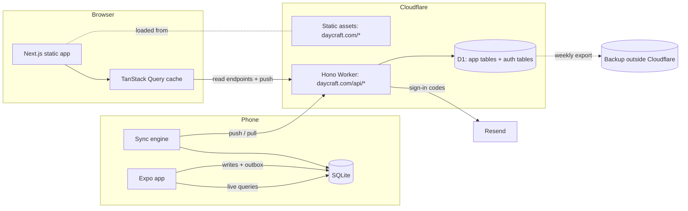
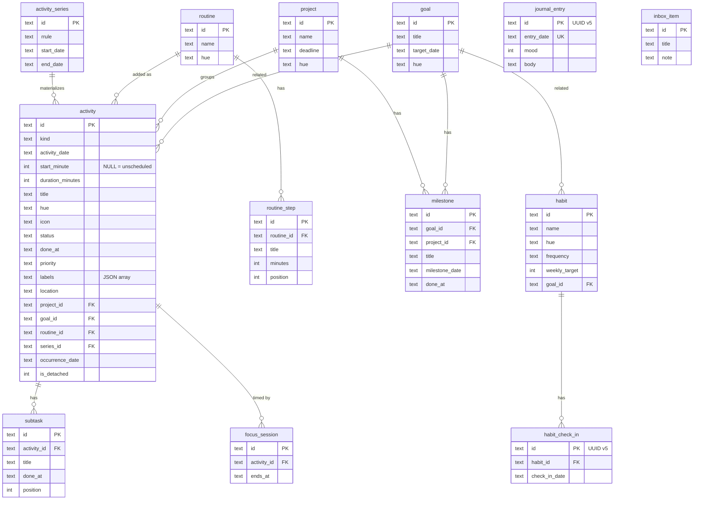
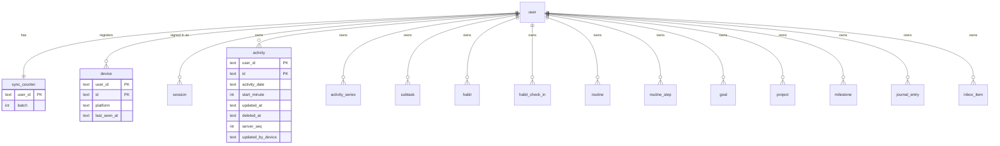
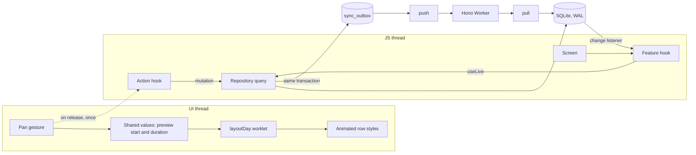

# Daycraft architecture plan: mobile, API, web

Status: **Proposed**, 2026-11-17. Written against mobile commit `43ba9e8` and the web repo's initial commit. No ADR here is decided until it is accepted and copied into root `docs/adr/` (and the affected app's `docs/status-and-decisions.md`). No application code was written. Moved from `apps/mobile/docs/development/data-layer-plan.md` to the monorepo root on 2026-11-17 because it covers every app.

This version replaces the earlier backend sections (self-hosted PostgreSQL on a VPS). What changed and why:

- **Web ships in v1 and syncs with mobile.** The API and the sync protocol must exist before v1, not after it.
- **v1 runs on free hosting.** That rules out a server you host (the VPS stays as a growth path, §9) and points to a platform that holds the API, the database and the web app together.
- **The repos become one monorepo**, so the rules both apps must share (ids, recurrence, sync rows) are one copy of the code.

Evidence rules: statements about the repos quote their docs. Platform limits and library features were read from the vendors' own pages on 2026-11-17 and are given with that date. Anything not confirmed is marked **verify**, and §12 lists every one of them.

## 0. Five questions, answered

| # | Question | Answer |
|---|---|---|
| 1 | Offline-first or online-first? | **Mobile is offline-first**: it reads and writes a local SQLite database and syncs in the background. **Web is online-first**: it reads and writes through the API. |
| 2 | Auth | Sign in with Apple and an email one-time code, from the first release that has accounts. Google is added with the Android launch. The mobile app works with no account; an account is what turns on sync and web. |
| 3 | Backend | **Hono on Cloudflare Workers**, with **Cloudflare D1** (SQLite) as the server database and **Better Auth** inside the API. Transactional email through **Resend**. |
| 4 | Do web and mobile share accounts and backend? | **Yes, from the first release of each.** Same API, same tables, same accounts. Web uses the same write path as mobile. |
| 5 | Does anything violate "solo developer shipping an MVP"? | No server to run, one vendor for the API, database and web, one language. Two parts are fenced because they are the expensive ones: hand-written sync (two-week timebox, PowerSync as the exit) and recurrence (four presets only). |

Things in the original brief or the repos that this plan does not follow, or corrects:

- The brief asked for timeline virtualization (FlashList vs FlatList). `architecture.md` already says: "A day has tens of rows, not thousands, so do not virtualize it." This plan keeps that rule (§8).
- The "previous PRD direction" (NestJS + PostgreSQL) is not recorded in either repo. It is treated as the brief's statement, not a decided item.
- `project-structure.md` listed `GLOSSARY.md` under "Not present yet". It now lives once at the monorepo root.
- Web is on TypeScript `^5`, mobile on `~6.0.3`. The monorepo needs one version (§3).

## 1. Executive summary

- **One monorepo: bun workspaces + Turborepo** (set up 2026-11-17). `apps/mobile`, `apps/web`, `apps/api`, plus two shared packages: `packages/domain` (pure TypeScript rules) and `packages/sync` (row schemas and the sync protocol).
- **Mobile:** Expo SDK 58 as it is today. `expo-sqlite` + Drizzle is the source of truth on the device. Every screen reads live queries. No state library.
- **API:** Hono on Cloudflare Workers. Three jobs: sign-in, sync (`push`, `pull`), and a few read endpoints for web.
- **Server database:** Cloudflare D1. It is SQLite, the same dialect as the device, so the server tables are the device tables plus `user_id` and `server_seq`, built from the same column definitions.
- **Web:** the existing Next.js 16 app, built as a **static export**, client-rendered against the API with TanStack Query, served as static files from Cloudflare.
- **Auth:** Better Auth inside the API, storing users in D1. Sign in with Apple, email code (sent by Resend), Google with Android.
- **Sync:** row-level last-write-wins on `updated_at`, soft deletes, a coalescing outbox on the device, and a per-user sequence as the pull cursor. Written in TypeScript in the API, not in SQL functions.
- **Hosting cost:** $0 through beta. **Workers Paid ($5 a month) before public launch**, because the free plan fails with errors, not slowdowns, when a daily limit is hit (§4).
- **Riskiest decision: writing sync by hand instead of buying it.** It cannot be tested until M2, and it is where solo projects lose months. It is chosen because the data is single-user, rows are small, and the protocol is two endpoints. It is fenced with a two-week timebox and a convergence test as an exit criterion.
- **Second-riskiest: one vendor for everything, on free limits.** Cloudflare holds the API, the database and the web app. Mitigated by a weekly export that leaves Cloudflare, and by Hono, which also runs on Node.

### 1.1 How picks were chosen

A candidate had to pass all five, in this order:

1. **The timeline works offline on the phone.**
2. **One person can build and run it.** Fewest services, vendors and languages.
3. **One language end to end.** TypeScript on the phone, the web and the server, so domain rules and validation are written once.
4. **Free for v1, with a known price for the next step.**
5. **Reversible.** Leaving a pick must not mean rewriting the app. Data leaves as a standard dump.

### 1.2 The stack

| Layer | Pick | Status |
|---|---|---|
| Repository | Monorepo: bun workspaces for installs, Turborepo for tasks and caching | Done 2026-11-17 (M0 monorepo gate passed) |
| Mobile app | Expo SDK 58, Expo Router, Uniwind, Reanimated, gesture-handler | Already in the repo |
| Mobile data | `expo-sqlite` + Drizzle ORM, live queries, no state library | Gate at M0 |
| Shared rules | `packages/domain`: time, ids, recurrence, timeline layout, validation | New |
| Shared sync contract | `packages/sync`: column definitions, Zod row schemas, push and pull payloads | New at M2 |
| API | Hono on Cloudflare Workers | M2 |
| Server database | Cloudflare D1 (SQLite) | M2 |
| Auth | Better Auth in the API: Apple, email code, Google with Android | M2 |
| Email | Resend | M2 |
| Web app | Next.js 16 static export, TanStack Query, Hono's typed client | M3 |
| Web hosting | Cloudflare, static assets on the same domain as the API | M3 |
| Mobile builds and updates | EAS Build, EAS Submit, EAS Update | M1 |
| Tests | Vitest for packages and API, `jest-expo` for mobile components, Maestro for flows | M0 onward |
| Crash reporting | Sentry (mobile and web) | M1 |
| Later, only if approved | `expo-notifications` (local), RevenueCat | After v1 |

Gates that can still change a pick. Each fallback keeps the schema and the app code:

| Gate | When | If it fails |
|---|---|---|
| Expo, Metro and Uniwind work from `apps/mobile` in a bun workspace | Passed 2026-11-17 | Separate repos. Shared code becomes a private package published from one of them. |
| Drizzle works with SDK 58, the React Compiler and Uniwind's Metro wrapper | M0, first day | Raw `expo-sqlite` with SQL files. Same repository functions. |
| Better Auth runs on Workers with D1, Apple id tokens and the Expo client | M2, first days | A managed auth service, verified in the API. Same tables for app data. |
| A 50-row push stays under the free plan's 10 ms CPU limit | M2 | Move to Workers Paid early ($5 a month). No code change. |
| Hand-written sync passes the 1,000-operation convergence test | M2, two weeks in | PowerSync. Schema unchanged. |

## 2. System architecture



Request paths, all on one domain so the web app needs no CORS and cookies stay first-party:

| Path | Served by | Used by |
|---|---|---|
| `daycraft.com/*` | Static files (the Next.js export) | Browsers |
| `daycraft.com/api/auth/*` | Better Auth, mounted in Hono | Mobile, web |
| `daycraft.com/api/v1/sync/push`, `/pull` | Hono | Mobile, and web for writes |
| `daycraft.com/api/v1/days/:date` and other reads | Hono | Web |
| `daycraft.com/api/v1/account` | Hono: export and delete | Mobile, web |

**Verify at M2:** that a Worker route on `daycraft.com/api/*` takes precedence over the static site on `daycraft.com/*`.

What each client is responsible for:

| | Mobile | Web | API |
|---|---|---|---|
| Source of truth while running | Local SQLite | The API | D1 |
| Writes | Local first, pushed later | Push, then update the cache | Last-write-wins upsert |
| Ids | Creates them (UUID v7 / v5) | Creates them, same code | Never creates app ids |
| Domain rules | `packages/domain` | `packages/domain` | Validation only, from `packages/sync` |
| Works offline | Yes | No | — |

## 3. Monorepo

```text
daycraft/
  package.json            # "private": true, "workspaces": ["apps/*", "packages/*"]
  bun.lock                # one lockfile
  turbo.json              # task graph and cache rules
  tsconfig.base.json      # strict, shared compiler options
  GLOSSARY.md             # single copy (today it is mirrored in both repos)
  docs/
    product/              # single copy of the shared product docs
    adr/                  # decisions that span apps
  apps/
    mobile/               # was mobile.daycraft.com, history kept
    web/                  # was web.daycraft.com, history kept
    api/                  # new at M2
  packages/
    domain/               # pure TypeScript. No React, no React Native, no SQL, no dependencies.
    sync/                 # column definitions, table registry, Zod schemas, protocol types
```

Rules:

- **Turborepo on top of bun workspaces.** bun owns installs and the lockfile (hoisted layout); Turborepo only runs tasks (`build`, `check-types`, `lint`, `test`) in dependency order and caches their results. Use the 2.x line with the `tasks` key in `turbo.json`.
- **Mobile dependencies are still added with `bunx expo install`,** run inside `apps/mobile`. Web and API use `bun add` inside their folder. `npx` refuses to run because the root declares bun in `devEngines`.
- **Keep Babel 7 at the root.** The create-turbo `@repo/eslint-config` package pulled `@babel/core` 8, bun hoisted it, and Metro's worklets plugin failed. That package was removed; any shared ESLint package must not bring Babel 8.
- **`packages/domain` is the domain layer from `architecture.md`, moved, not replaced.** The three layers stay: routes, features, primitives, and domain. Domain now lives in a package with no dependencies, which enforces "no React, no RN imports" by construction rather than by review.
- **Design tokens stay per app for v1.** Both apps use Tailwind v4, so a shared `packages/tokens` CSS file is possible later. **Verify** that Uniwind's theme layer accepts an imported token file before doing it.
- **One React version.** Both apps are on React 19.3.0 today. Expo's monorepo guide says duplicate React or React Native versions are not supported.
- **One TypeScript version.** Mobile is on `~6.0.3`. Web moves from `^5` to the same version. **Verify** Next.js 16 support for TypeScript 6 first.

`turbo.json` sketch:

```json
{
  "$schema": "https://turborepo.dev/schema.json",
  "tasks": {
    "build": { "dependsOn": ["^build"], "outputs": ["dist/**", "out/**"] },
    "check-types": { "dependsOn": ["^build"] },
    "lint": {},
    "test": { "dependsOn": ["^build"] },
    "dev": { "cache": false, "persistent": true }
  }
}
```

- `^build` means "build my dependencies first", so `packages/domain` and `packages/sync` are built before any app typechecks against them. If the packages are consumed as TypeScript source instead of built output, `build` is dropped from them and `check-types` loses the `dependsOn`. The live `turbo.json` is still the create-turbo default (`check-types` depends on `^check-types`); change it when the first package lands.
- `dev` runs Metro, `next dev` and `wrangler dev`. It is never cached and nothing depends on it.
- Mobile store builds stay on EAS. Turborepo does not run `eas build`; caching a native build locally gains nothing.
- Environment: strict mode is the default, so variables a task reads (for example `EXPO_PUBLIC_API_URL`) go in that task's `env` list, or the cache can serve a build made with a different value.
- Remote cache: optional. Vercel's is free on all plans, even for apps not hosted on Vercel, and a self-hosted one is possible. Turn it on when GitHub Actions runs the checks, not before.

Checked against Turborepo's docs on 2026-11-17 (`turborepo.dev`): the `tasks` key, `dependsOn` with `^`, `outputs`, `cache`, `persistent`, strict environment mode by default, and free optional remote caching. Not found in those docs: npm workspaces named explicitly, and any Expo or React Native guidance. Turborepo reads the package manager from the root `package.json` (`devEngines.packageManager`, or the older `packageManager` field), so the root declares bun there (`devEngines.packageManager`, bun 1.2.17).

Checked against Expo's monorepo guide on 2026-11-17: npm workspaces have first-class support; Metro is configured automatically for monorepos since SDK 52 when `expo/metro-config` is used; the guide's own layout is `apps/` plus `packages/`. Checked 2026-11-17: `withUniwindConfig` keeps it working; the iOS export from `apps/mobile` bundles the same 1,750 modules (3.9 MB) as before the move.

Moving the two repos in: import each with its history (for example `git subtree add --prefix apps/mobile <repo> <branch>`). Mobile has seven commits and web has one, so this is a small, one-time step.

## 4. Hosting for v1

### 4.1 Free allowances

Read from each vendor's page on 2026-11-17.

| Service | Free allowance | When exceeded | Next step and price |
|---|---|---|---|
| Cloudflare Workers | 100,000 requests a day, 10 ms CPU per request | Requests fail with error 1027 until 00:00 UTC | Workers Paid, $5 a month minimum: 10 million requests a month, CPU up to 30 s by default |
| Cloudflare D1 | 5 million rows read and 100,000 rows written a day, 5 GB total, 10 databases, **500 MB per database** | Queries return errors until 00:00 UTC. A full database blocks inserts | Included in Workers Paid: 25 billion reads and 50 million writes a month, 10 GB per database |
| D1 backups (Time Travel) | 7 days | — | 30 days on Paid |
| Resend | 3,000 emails a month, 100 a day | **verify** what happens at the cap | Paid plan |
| EAS Build | 15 iOS and 15 Android builds a month, low-priority queue (the page warns of 90+ minute waits at peak) | — | Local builds with `bunx expo run:*` are free |
| EAS Update | 1,000 monthly active users | No overage on Free | Paid plan |
| Sentry | 5,000 errors, 1 user, 30-day lookback | — | Paid plan |

Costs no free tier removes: the Apple Developer Program, a Google Play developer account, and the domain. These are standard fees and were not re-checked today.

### 4.2 What the free plan holds

My estimate, not a measurement. Assumed per daily active user: about 20 sync requests from the phone, about 40 requests from a web session, and about 50 rows written.

| Limit | Holds roughly | Comment |
|---|---|---|
| 100,000 Worker requests a day | 2,000–5,000 daily users | Depends on how much web is used |
| 100,000 D1 rows written a day | about 2,000 daily users | **Verify** whether index updates count as rows written |
| 500 MB per database | a few hundred users with a year of data each | The real ceiling on Free |
| 100 emails a day | 100 email sign-ins a day | Apple and Google sign-ins do not send email |
| 10 ms CPU per request | — | The one limit a single request can hit: a large push spends CPU on parsing and validation. Pushes are capped at 50 rows. |

Decision: **stay on Free through private beta, move to Workers Paid before public launch.** The free plan fails hard. A phone barely notices, because it is offline-first and retries the next day. A web user sees errors. $5 a month removes the CPU limit and the daily caps, and raises the database ceiling to 10 GB.

### 4.3 Backups and what you still own

- D1 Time Travel restores to any point in the last 7 days (30 on Paid).
- A scheduled job (GitHub Actions) runs `wrangler d1 export` weekly and stores the dump outside Cloudflare. One restore into a scratch database is done before public launch, and its time is written down.
- Secrets (Apple key, Resend key, auth secret) live in Worker secrets, never in the repo.
- An uptime check from outside on `/api/v1/health`.

## 5. Data design

### 5.1 Conventions (device and server)

| Rule | Detail |
|---|---|
| Names | Singular `snake_case` tables named after `GLOSSARY.md` terms: `activity`, `subtask`, `habit_check_in`, `routine_step`, `milestone`, `journal_entry`, `inbox_item`. |
| Floating local time | `activity_date` is `'YYYY-MM-DD'`, `start_minute` is 0–1439 (`architecture.md`: "floating local time"). No time zone is stored on activities. |
| Real timestamps | ISO-8601 UTC strings with milliseconds, on the device and on the server (both are SQLite). Fixed width, so string order is time order. |
| Hue | `hue TEXT` restricted to the nine `ActivityHue` values. Hex values are never stored; tokens own them. |
| Icon | `icon TEXT`, an `IconName` from `@daycraft/domain` (ADR-0002). No `CHECK`, so new icons need no migration. |
| Done | `done_at` timestamp, `NULL` when not done. The domain type keeps `done: boolean`. |
| Derived values | Streaks, weekly counts, goal, project and daily progress are never stored (`product-overview.md`: "computed and never stored"). |
| Sync columns | Every synced row has `created_at`, `updated_at`, `deleted_at`. Deleting sets `deleted_at`. Every read filters `deleted_at IS NULL`. |
| IDs | `id TEXT` holding a UUID. Opaque to feature code. |

How the product concepts map to tables:

| Concept | Storage |
|---|---|
| Activity | `activity` row. `kind` is `task`, `event` or `routine`. |
| Task | `activity` with `kind = 'task'`. Unscheduled means `start_minute IS NULL`. |
| Event | `activity` with `kind = 'event'`. A `CHECK` forbids a null `start_minute`. `location` is used. |
| Routine | `routine` plus `routine_step`. "Add to today" inserts one `activity` (`kind = 'routine'`, `routine_id` set) and copies the steps into `subtask`. |
| Habit | `habit` plus one `habit_check_in` row per checked date. Unchecking soft-deletes the row. |
| Goal | `goal` plus `milestone` rows with `goal_id` set. |
| Project | `project` plus `milestone` rows with `project_id` set. Its tasks are `activity` rows with `project_id` set. |
| Journal | `journal_entry`, one per `entry_date`. |
| Inbox | `inbox_item`. "Plan" inserts an `activity` and soft-deletes the item in one transaction. |
| Hue | The `hue` column on `activity`, `activity_series`, `habit`, `routine`, `goal`, `project`. Mood hue is derived from `mood`. |
| Repeat | `activity_series.rrule`. The domain `Repeat` value is derived from it. |
| Labels | JSON array of label keys in `activity.labels`. The five labels are a fixed set in `packages/domain`. |
| Focus | `focus_session`, device-only, never synced. Stores `ends_at`, as `interaction-patterns.md` requires. |

Three modelling calls that the docs do not make. Each needs your yes (ADR-0008):

1. **Project tasks are activities.** The prototype keeps `Project.tasks` separate from `Activity.projectId`. One table removes the duplicate. Board columns come from `status` (`todo`, `doing`, `done`). A project task's due date is its `activity_date` with no start time, which is exactly the glossary's "Unscheduled".
2. **A goal's related habits and tasks** are a nullable `goal_id` on `habit` and `activity`. The prototype only has display tags.
3. **`activity_date` is required**, as in the prototype type. A task with no date at all stays an Inbox item.

### 5.2 Device schema (SQLite)



DDL sketch. `-- sync` stands for the three columns `created_at TEXT NOT NULL, updated_at TEXT NOT NULL, deleted_at TEXT`. `HUE` stands for `CHECK (hue IN ('clay','amber','sun','sage','pine','sky','iris','rose','slate'))`.

```sql
PRAGMA journal_mode = WAL;       -- recommended by the expo-sqlite docs for new databases
PRAGMA foreign_keys = ON;        -- per connection, see the note below

CREATE TABLE project (
  id TEXT PRIMARY KEY NOT NULL,
  name TEXT NOT NULL,
  icon TEXT NOT NULL,
  hue TEXT NOT NULL HUE,
  deadline TEXT,                               -- 'YYYY-MM-DD'
  description TEXT NOT NULL DEFAULT ''
  -- sync
);

CREATE TABLE goal (
  id TEXT PRIMARY KEY NOT NULL,
  title TEXT NOT NULL,
  description TEXT NOT NULL DEFAULT '',
  target_date TEXT,
  hue TEXT NOT NULL HUE
  -- sync
);

CREATE TABLE milestone (                       -- on a goal or on a project, never both
  id TEXT PRIMARY KEY NOT NULL,
  goal_id TEXT REFERENCES goal(id),
  project_id TEXT REFERENCES project(id),
  title TEXT NOT NULL,
  milestone_date TEXT,                         -- project milestones only
  done_at TEXT,
  position INTEGER NOT NULL DEFAULT 0,
  -- sync
  CHECK ((goal_id IS NULL) <> (project_id IS NULL))
);
CREATE INDEX milestone_goal ON milestone (goal_id) WHERE goal_id IS NOT NULL;
CREATE INDEX milestone_project ON milestone (project_id) WHERE project_id IS NOT NULL;

CREATE TABLE routine (
  id TEXT PRIMARY KEY NOT NULL,
  name TEXT NOT NULL,
  icon TEXT NOT NULL,
  hue TEXT NOT NULL HUE
  -- sync
);

CREATE TABLE routine_step (
  id TEXT PRIMARY KEY NOT NULL,
  routine_id TEXT NOT NULL REFERENCES routine(id),
  title TEXT NOT NULL,
  minutes INTEGER NOT NULL CHECK (minutes > 0),
  position INTEGER NOT NULL
  -- sync
);
CREATE INDEX routine_step_routine ON routine_step (routine_id, position);

CREATE TABLE activity_series (                 -- the repeat rule plus the values new occurrences copy
  id TEXT PRIMARY KEY NOT NULL,
  rrule TEXT NOT NULL,                         -- RFC 5545 subset, see 5.5
  start_date TEXT NOT NULL,
  end_date TEXT,                               -- last date that repeats, NULL = open
  kind TEXT NOT NULL CHECK (kind IN ('task','event','routine')),
  title TEXT NOT NULL,
  hue TEXT NOT NULL HUE,
  icon TEXT NOT NULL,
  start_minute INTEGER CHECK (start_minute BETWEEN 0 AND 1439),
  duration_minutes INTEGER NOT NULL,
  notes TEXT NOT NULL DEFAULT '',
  priority TEXT NOT NULL DEFAULT 'none',
  labels TEXT NOT NULL DEFAULT '[]',
  location TEXT NOT NULL DEFAULT '',
  project_id TEXT REFERENCES project(id),
  routine_id TEXT REFERENCES routine(id),
  subtask_titles TEXT NOT NULL DEFAULT '[]'    -- JSON array copied into subtask rows
  -- sync
);

CREATE TABLE activity (
  id TEXT PRIMARY KEY NOT NULL,
  kind TEXT NOT NULL CHECK (kind IN ('task','event','routine')),
  activity_date TEXT NOT NULL,
  start_minute INTEGER CHECK (start_minute BETWEEN 0 AND 1439),
  duration_minutes INTEGER NOT NULL DEFAULT 30 CHECK (duration_minutes >= 0),
  title TEXT NOT NULL,
  hue TEXT NOT NULL HUE,
  icon TEXT NOT NULL,
  status TEXT NOT NULL DEFAULT 'todo' CHECK (status IN ('todo','doing','done')),
  done_at TEXT,
  notes TEXT NOT NULL DEFAULT '',
  priority TEXT NOT NULL DEFAULT 'none' CHECK (priority IN ('none','low','medium','high')),
  labels TEXT NOT NULL DEFAULT '[]',
  location TEXT NOT NULL DEFAULT '',
  project_id TEXT REFERENCES project(id),
  goal_id TEXT REFERENCES goal(id),
  routine_id TEXT REFERENCES routine(id),
  series_id TEXT REFERENCES activity_series(id),
  occurrence_date TEXT,                        -- the date the rule produced, kept when the row is moved
  is_detached INTEGER NOT NULL DEFAULT 0,      -- 1 = edited by hand, series edits skip it
  -- sync
  CHECK (kind = 'task' OR start_minute IS NOT NULL),            -- only a task can be unscheduled
  CHECK (start_minute IS NULL OR start_minute + duration_minutes <= 1440),
  CHECK ((status = 'done') = (done_at IS NOT NULL)),
  CHECK ((series_id IS NULL) = (occurrence_date IS NULL))
);
CREATE INDEX activity_day ON activity (activity_date, start_minute) WHERE deleted_at IS NULL;
CREATE INDEX activity_open_task ON activity (status, activity_date)
  WHERE kind = 'task' AND deleted_at IS NULL;
CREATE INDEX activity_project ON activity (project_id)
  WHERE project_id IS NOT NULL AND deleted_at IS NULL;
CREATE UNIQUE INDEX activity_occurrence ON activity (series_id, occurrence_date)
  WHERE series_id IS NOT NULL;

CREATE TABLE subtask (
  id TEXT PRIMARY KEY NOT NULL,
  activity_id TEXT NOT NULL REFERENCES activity(id),
  title TEXT NOT NULL,
  done_at TEXT,
  position INTEGER NOT NULL
  -- sync
);
CREATE INDEX subtask_activity ON subtask (activity_id, position) WHERE deleted_at IS NULL;

CREATE TABLE habit (
  id TEXT PRIMARY KEY NOT NULL,
  name TEXT NOT NULL,
  icon TEXT NOT NULL,
  hue TEXT NOT NULL HUE,
  frequency TEXT NOT NULL CHECK (frequency IN ('daily','weekly')),
  weekly_target INTEGER NOT NULL DEFAULT 0,
  goal_id TEXT REFERENCES goal(id),
  position INTEGER NOT NULL DEFAULT 0,
  -- sync
  CHECK ((frequency = 'daily' AND weekly_target = 0)
      OR (frequency = 'weekly' AND weekly_target BETWEEN 2 AND 6))
);

CREATE TABLE habit_check_in (                  -- row exists and is not deleted = checked in
  id TEXT PRIMARY KEY NOT NULL,                -- UUID v5 of (habit_id, check_in_date)
  habit_id TEXT NOT NULL REFERENCES habit(id),
  check_in_date TEXT NOT NULL,
  -- sync
  UNIQUE (habit_id, check_in_date)
);
CREATE INDEX habit_check_in_date ON habit_check_in (check_in_date) WHERE deleted_at IS NULL;

CREATE TABLE journal_entry (
  id TEXT PRIMARY KEY NOT NULL,                -- UUID v5 of entry_date
  entry_date TEXT NOT NULL UNIQUE,
  mood INTEGER NOT NULL CHECK (mood BETWEEN 1 AND 5),
  body TEXT NOT NULL DEFAULT ''
  -- sync
);

CREATE TABLE inbox_item (
  id TEXT PRIMARY KEY NOT NULL,
  title TEXT NOT NULL,
  note TEXT NOT NULL DEFAULT ''
  -- sync (created_at is the capture time)
);

-- Device-only. Never synced, no sync columns.
CREATE TABLE focus_session (
  id TEXT PRIMARY KEY NOT NULL,
  activity_id TEXT REFERENCES activity(id),
  planned_seconds INTEGER NOT NULL,
  started_at TEXT NOT NULL,
  ends_at TEXT,                                -- NULL while paused
  remaining_seconds INTEGER,                   -- set while paused
  ended_at TEXT
);

-- Added in M2. Device-only.
CREATE TABLE sync_outbox (                     -- the set of rows that changed since the last push
  table_name TEXT NOT NULL,
  row_id TEXT NOT NULL,
  queued_at TEXT NOT NULL,
  PRIMARY KEY (table_name, row_id)
);
CREATE TABLE sync_state (key TEXT PRIMARY KEY NOT NULL, value TEXT NOT NULL);
-- keys: device_id, pull_cursor, last_synced_at
```

Notes that change how the code is written:

- `PRAGMA foreign_keys` is per connection. The expo-sqlite docs state that `withExclusiveTransactionAsync` runs on a new connection, so the pragma does not carry over. Use `withTransactionAsync` (or the sync transaction API) for writes, and open one connection.
- Partial indexes (`WHERE deleted_at IS NULL`) keep tombstones out of every hot query.
- App settings (appearance, selected Calendar view) go in `expo-sqlite/kv-store`, which ships inside `expo-sqlite`. No AsyncStorage or MMKV dependency.

### 5.3 Server schema (D1)

D1 is SQLite, so the server tables are the device tables with three changes. The shared column definitions live in `packages/sync` and both schemas are built from them, so a column added on one side cannot be forgotten on the other.

| Aspect | Server |
|---|---|
| Tenant | `user_id TEXT NOT NULL` first in every table. It is always taken from the verified session, never from the request body. |
| Primary key | `(user_id, id)`. Needed because `journal_entry.id` is derived from the date alone, so it is unique per user, not globally. |
| Sync cursor | `server_seq INTEGER NOT NULL`, from the per-user counter (§5.6) |
| Provenance | `updated_by_device TEXT` |
| Indexes | Every index leads with `user_id`. Each synced table also gets `(user_id, server_seq)` for pull. |
| Foreign keys | **None between app tables.** Rows arrive in pages and in any order across devices. The device enforces relationships; the server stores rows and filters every read by `user_id`, so a reference can only point inside the same user's data. |
| Not present | `focus_session`, `sync_outbox`, `sync_state` |
| Added | `sync_counter`, `device`, and the auth library's tables (user, session, account, verification) |



Every app table carries the same trailing columns as `activity`.

```sql
CREATE TABLE activity (
  user_id TEXT NOT NULL,
  id TEXT NOT NULL,
  -- ... every column and CHECK of the device table, without REFERENCES ...
  created_at TEXT NOT NULL,
  updated_at TEXT NOT NULL,
  deleted_at TEXT,
  server_seq INTEGER NOT NULL,
  updated_by_device TEXT,
  PRIMARY KEY (user_id, id)
);
CREATE INDEX activity_pull ON activity (user_id, server_seq);
CREATE INDEX activity_day ON activity (user_id, activity_date, start_minute) WHERE deleted_at IS NULL;

CREATE TABLE sync_counter (                    -- one row per user, created at sign-up
  user_id TEXT PRIMARY KEY NOT NULL,
  batch INTEGER NOT NULL DEFAULT 0
);

CREATE TABLE device (
  user_id TEXT NOT NULL,
  id TEXT NOT NULL,
  platform TEXT NOT NULL CHECK (platform IN ('ios','android','web')),
  last_seen_at TEXT NOT NULL,
  PRIMARY KEY (user_id, id)
);
```

**Verify at M2:** the id type and table names Better Auth creates, so `user_id` matches.

### 5.4 The queries that matter

Day timeline on the device (Today, Calendar day view, agenda):

```sql
-- 1. Activities for the date. Uses activity_day.
SELECT * FROM activity
WHERE activity_date = :date AND deleted_at IS NULL
ORDER BY start_minute IS NULL, start_minute, duration_minutes;

-- 2. Subtask counts for the "2/4" tag. Uses subtask_activity.
SELECT s.activity_id, COUNT(*) AS total, COUNT(s.done_at) AS done
FROM subtask s
JOIN activity a ON a.id = s.activity_id
WHERE a.activity_date = :date AND a.deleted_at IS NULL AND s.deleted_at IS NULL
GROUP BY s.activity_id;
```

The same two queries run in the API for web's `GET /api/v1/days/:date`, with `user_id = :user` added. The repository returns domain `Activity` values. `layoutDay` takes those with `start !== null`. The sort matches `timeline-guide.md` §3 ("sort them by `start`, then by `durationMinutes`").

Others, all served by the indexes above:

| Screen | Query shape |
|---|---|
| Week strip, month grid dots | `SELECT activity_date, hue FROM activity WHERE activity_date BETWEEN :from AND :to AND kind <> 'routine' AND deleted_at IS NULL GROUP BY activity_date, hue` |
| Upcoming (14 days) | Range on `activity_date`, minus `kind = 'routine' AND series_id IS NOT NULL` (the doc's "filter out repeating routine instances") |
| Tasks filters | `kind = 'task'` with `status`, `activity_date = :today`, `start_minute IS NULL` |
| Habit row, heatmap | `habit_check_in WHERE check_in_date BETWEEN :from AND :to`. Streaks are computed in `packages/domain`. |
| Project detail | `activity WHERE project_id = :id`, grouped by `status` in the domain |

### 5.5 Recurrence

Two different things are called "recurring" in the product, and only one is a rule:

- **Habit frequency is not recurrence.** "4× a week" is a target, not a schedule. It stays as `frequency` + `weekly_target`.
- **Activity repeat** (`never`, `daily`, `weekdays`, `weekly`) is a rule.

Decision: store an **RFC 5545 RRULE subset** in `activity_series.rrule`, and **materialize** each occurrence as a normal `activity` row.

| Repeat | `rrule` |
|---|---|
| daily | `FREQ=DAILY` |
| weekdays | `FREQ=WEEKLY;BYDAY=MO,TU,WE,TH,FR` |
| weekly | `FREQ=WEEKLY;BYDAY=TU` (weekday of `start_date`) |

- The parser and expander live in `packages/domain/recurrence.ts`. They accept `FREQ`, `INTERVAL` and `BYDAY` only, and reject everything else. No `rrule` npm package: it works on `Date` in UTC, which fights floating local dates.
- `ensureOccurrences({ seriesId, from, to })` inserts missing rows with `INSERT OR IGNORE`. It runs when a series is created or edited, and before any date-range read that reaches past what is already covered.
- An occurrence's id is UUID v5 of `(series_id, occurrence_date)`. Mobile and web both materialize with the same code, so the same date always produces the same row.
- Deleting one occurrence leaves a tombstone, so it is not created again.
- Moving, resizing or editing one occurrence sets `is_detached = 1`. Changing the series rewrites future rows that are not detached and not done.
- **Web materializes too.** When web opens a date range the series covers but no rows exist, it creates the occurrences in the browser with the same function and pushes them. The server never generates rows.

Why materialize: completion, drag and subtasks are per occurrence, so each occurrence needs a row anyway. With virtual expansion every query becomes "stored rows plus expanded rules minus exceptions", written twice (device SQL and API SQL).

Open product question, needed before M1: when the user edits a repeating activity, does the editor ask "this one or all following"? Assumed until answered: time, duration and completion change this occurrence only. Changing **Repeat** changes the series from that date forward.

### 5.6 Sync protocol

| Topic | Decision |
|---|---|
| Unit | The whole row. Rows are deliberately small: subtasks, steps, check-ins and milestones are their own rows, so ticking a subtask on the phone cannot overwrite a title edited on the web. |
| Conflict rule | Last write wins on `updated_at`. The upsert is `INSERT … ON CONFLICT (user_id, id) DO UPDATE SET … WHERE excluded.updated_at > activity.updated_at`. On a tie the server row stays. **Verify** this upsert form on D1 on the first day of M2. |
| Clock skew | The API replaces any `updated_at` more than five minutes ahead of its own clock with its own time. The pull cursor never uses device clocks. |
| Device change tracking | Every repository write adds `(table_name, row_id)` to `sync_outbox` in the same transaction. Ten resize commits on one activity are one outbox row. Push sends the row as it is now. |
| First sign-in | Enqueue every local row once. |
| Push | `POST /api/v1/sync/push` with at most 50 rows, parents before children. The API runs **one D1 batch**, which D1 documents as a single transaction: first `UPDATE sync_counter SET batch = batch + 1 WHERE user_id = ?`, then one upsert per row with `server_seq = batch × 1000 + position`. The device clears an outbox entry only if the row has not changed again since it was read. |
| Why the counter works | D1 runs one query at a time per database and a batch is atomic, so batch numbers rise strictly per user and a lower `server_seq` can never commit after a higher one. One extra row write per push, not per row. |
| Pull | `GET /api/v1/sync/pull?cursor=…`. One D1 batch of one `SELECT … WHERE user_id = ? AND server_seq > ? ORDER BY server_seq LIMIT 500` per table. The API merges them, keeps the lowest 500, and returns them with the new cursor and a `more` flag. The device applies a page in one transaction with `PRAGMA defer_foreign_keys = ON`, then stores the cursor. A pulled row never overwrites a row still in the outbox with a newer `updated_at`. |
| Validation | Every pushed row is parsed with the Zod schema from `packages/sync`, and `user_id` comes from the session. A rejected row is reported back by id and stays in the outbox, flagged, so one bad row cannot block the rest. |
| Deletes | Soft, as tombstones. The device purges tombstones 30 days after they are pushed. The server keeps them 90 days. A device whose cursor is older than that does a full pull. |
| Device identity | UUID v7 made at first launch (web: on first sign-in, kept in local storage), registered in `device`. |
| IDs | UUID v7 for user-created rows. UUID v5 for `habit_check_in`, `journal_entry` and series occurrences. Both live in `packages/domain/id.ts`; the caller passes random bytes (`expo-crypto` on mobile, `crypto.getRandomValues` on web). |
| When (mobile) | On foreground, 2 s after the last local write, and on sign-in. No realtime connection and no background task in v1. |
| Rejected | Operation log (compaction, replay order and per-field merge, none of which a single-user planner needs). CRDTs (same reason, plus a library). Sync logic in database functions (D1 has none, and TypeScript keeps it testable and portable). |

### 5.7 How web reads and writes

- **Reads:** a handful of endpoints that run the queries in §5.4 for the signed-in user: day, date range (week strip, month, Upcoming), tasks by filter, habits with check-ins for a range, routines, goals, projects, journal. Each is cached by TanStack Query.
- **Writes:** web builds the full changed row with `updated_at = now` and sends it to the same `push` endpoint mobile uses. TanStack Query updates the cache first and rolls back with an error toast if the push fails, which meets `architecture.md`'s optimistic-update rule.
- **Seeing mobile changes:** refetch on window focus and after each own write. A cheap `GET /api/v1/sync/head` (the user's current batch number) can be polled later while a tab is visible. Not in v1, to keep requests inside the free allowance.
- **Typed client:** Hono's RPC client (`hc`) typed from `apps/api`. **Verify** it in the current Hono docs at M3; if it does not fit, a fetch wrapper with the Zod schemas from `packages/sync`.

### 5.8 Migrations

- **Device:** Drizzle Kit generates numbered `.sql` files into `apps/mobile/src/data/db/migrations/` (`dialect: 'sqlite'`, `driver: 'expo'`), applied at start-up with `useMigrations` from `drizzle-orm/expo-sqlite/migrator` while the splash screen is up.
- **Server:** Drizzle Kit generates SQL into `apps/api/migrations/`, applied with Wrangler's D1 migrations command. Better Auth's tables are generated with its CLI (`npx auth@latest generate`) and committed as a migration, because its docs say the CLI cannot reach D1 directly. **Verify** the Wrangler command name and Drizzle's D1 settings at M2.
- **Rules for both:** forward only. A shipped migration is never edited. Columns are added, never renamed in place (rename = add, copy, drop in a later release). The server ships first and accepts payloads from the previous app version, because old app builds stay installed for months.
- **Tests:** every device migration gets a test that opens a database at the previous version with fixture rows, applies it, and checks the rows survive. **Verify at M0** which SQLite those tests run on in Node (`node:sqlite` or a dev-only `better-sqlite3`), since `expo-sqlite` does not run under Jest.

## 6. Per-app architecture

### 6.1 Mobile (`apps/mobile`)

The three layers in `architecture.md` stay. Domain moves to `packages/domain`. Folders are created when the first file needs them (`project-structure.md`: "do not scaffold empty folders").

```text
apps/mobile/src/
  app/                          # routes only (navigation-and-modules.md)
    _layout.tsx                 # opens the database, runs migrations, holds the splash, starts sync
  features/
    today/
      use-day-activities.ts     # live query -> domain Activity[] -> layoutDay
      use-activity-actions.ts   # complete, move, resize, delete: repository call + toast
      timeline/                 # rows, spine, now line, drag gesture (worklets)
    inbox/ tasks/ habits/ routines/ goals/ projects/ focus/ journal/ upcoming/
    activity-editor/            # draft state, domain validation, save
    account/                    # M2: sign-in, sync status row in More, account deletion
  components/ui/                # primitives only, unchanged
  data/
    db/
      client.ts                 # openDatabaseSync, PRAGMAs, the Drizzle instance
      schema.ts                 # Drizzle tables built from packages/sync column definitions
      migrations/               # generated by drizzle-kit. Never hand-edit a shipped file.
    repositories/
      activity-repository.ts    # queries + mutations, row <-> domain mapping, outbox entry
      habit-repository.ts  routine-repository.ts  goal-repository.ts
      project-repository.ts  journal-repository.ts  inbox-repository.ts  focus-repository.ts
    use-live.ts                 # the one place that touches Drizzle's live-query hook
    data-error.ts               # DataError and DataErrorCode
    fixtures/                   # the prototype's sample day, dev seed only
    sync/                       # M2
      outbox.ts  push.ts  pull.ts  sync-engine.ts
      http-transport.ts         # SyncTransport: push(rows), pull(cursor)
      auth-client.ts            # Better Auth Expo client
  hooks/                        # useNow, useSelectedDate, useToast
```

Import rules, added to the existing ones:

- `features/` imports `data/repositories` and `data/use-live`. It never imports `drizzle-orm`, `expo-sqlite` or `data/db`.
- `packages/domain` imports nothing.
- `data/sync/` is started from one place (`app/_layout.tsx`). No feature knows sync exists, apart from `features/account`.



**State conventions**

| Kind | Where | Source |
|---|---|---|
| Persistent data | SQLite, read with live queries | this plan |
| Selected date | Small context (`useSelectedDate`) | `architecture.md`, unchanged |
| Sheet identity | Route params | `architecture.md`, unchanged |
| Draft fields, filters, expanded cards | `useState` in the owning component | `architecture.md`, unchanged |
| Drag preview | Reanimated shared values, UI thread only | `timeline-guide.md` §10 |
| Toast | One context provider at the root | new, no library |
| Now | `useNow(intervalMs)` | `architecture.md`, unchanged |
| Session | `@better-auth/expo` client, stored in `expo-secure-store` | M2 |

How repositories feed the UI: a repository exports query builders (`dayActivitiesQuery(date)`) and mutations (`moveActivity({ id, start })`). A feature hook passes the query to `useLive`, maps rows to domain values and runs domain functions. A mutation writes SQLite and the change listener re-runs the live query: no cache to invalidate, no second copy of the data. The local write is the optimistic update. If it throws, the drag preview reverts and an error toast shows.

### 6.2 API (`apps/api`)

```text
apps/api/
  wrangler.jsonc               # D1 binding, routes on daycraft.com/api/*, cron for tombstone purge
  migrations/                  # D1 migrations (app tables + auth tables)
  src/
    index.ts                   # Hono app: routes, error handler, request id
    env.ts                     # Bindings type (DB, secrets)
    auth.ts                    # Better Auth: D1, Apple, email code (Resend), Expo plugin
    middleware/
      require-session.ts       # puts userId on the context, 401 otherwise
    routes/
      sync.ts                  # POST /v1/sync/push, GET /v1/sync/pull, GET /v1/sync/head
      read.ts                  # GET /v1/days/:date, /v1/range, /v1/tasks, /v1/habits, ...
      account.ts               # GET /v1/account/export, DELETE /v1/account
      health.ts
    db/
      schema.ts                # Drizzle sqlite tables built from packages/sync + user_id, server_seq
      client.ts                # drizzle(env.DB)
    sync/
      push.ts  pull.ts         # the batch logic in §5.6
    jobs/
      purge-tombstones.ts      # scheduled, removes tombstones older than 90 days
```

API conventions:

- Every route under `/v1` runs `require-session`. `user_id` is read from the context, never from input.
- Input is parsed with Zod schemas from `packages/sync`. A parse failure is a 400 with a stable error code, never the Zod message.
- Errors are JSON `{ code, message }` with codes from a const object (`ApiErrorCode`). Clients map codes to the toast copy in `interaction-patterns.md`.
- Account deletion removes the user's rows from every table and the auth tables in one batch. The App Store requires deletion once accounts exist.
- Every request logs a request id, route, status, duration and `user_id` hash, never row contents.
- Function parameters: more than two, or two of the same type, take one object parameter whose type is a named `interface` or `type` at the top of the file. Enumerations are const objects with a same-named union type.

### 6.3 Web (`apps/web`)

Decision: **Next.js 16 with `output: 'export'`**, client-rendered against the API. This closes the web repo's open decision W1 with its own option "a client data library against an API".

Why static export:

- The product surface is signed-in and personal. Server rendering gives it no SEO and no data advantage, because the data is behind the user's session in the API.
- Static files cost nothing to serve and do not use the Worker request allowance.
- No server runtime to adapt: no OpenNext, no Node compatibility questions.

What it gives up: Server Actions, request-time Server Components, middleware, and dynamic route segments without `generateStaticParams`. Ids therefore go in the query string (`/projects?id=…`) or in client-side state. Marketing pages are still statically rendered at build time.

Fallback if a server feature becomes necessary: deploy the same app through the OpenNext Cloudflare adapter, which lists all Next.js 16 minor versions as supported. Its page and Cloudflare's limits page disagree on the free plan's size limit (3 MiB compressed vs no compressed limit), so **verify** before relying on it.

```text
apps/web/src/
  app/
    (marketing)/page.tsx        # static landing page
    (app)/today/page.tsx        # client components from here down
    (app)/inbox/ tasks/ habits/ routines/ goals/ projects/ journal/ focus/
    sign-in/page.tsx
  features/                     # same module names as mobile
    today/timeline/             # pointer-event drag, as the prototype's pDown/pMove/pUp
  lib/
    api.ts                      # typed client
    query-client.ts             # TanStack Query setup: refetch on focus, retry policy
    auth-client.ts              # Better Auth web client (cookies, same origin)
  components/ui/                # web primitives, same tokens
```

- Domain rules come from `packages/domain`: `layoutDay`, `mapTimeToY`, snapping, next free slot, formatting, recurrence, ids.
- State: server data in TanStack Query, selected date in the URL, drafts in `useState`.
- The desktop layout (side detail panel instead of sheets) follows `timeline-guide.md` §15.

### 6.4 Error, empty and loading conventions

- **Repositories (mobile)** throw `DataError` with a `code` from `DataErrorCode` (`NOT_FOUND`, `CONSTRAINT`, `MIGRATION_FAILED`, `UNKNOWN`). They never return `null` to mean failure.
- **Feature hooks** return `{ status: 'loading' } | { status: 'ready'; data } | { status: 'error'; retry }` on both apps.
- **Action hooks** catch the error, show a toast and report to Sentry. Proposed copy, to add to `interaction-patterns.md` if accepted: `Couldn't save · try again`.
- **Loading on mobile:** local reads finish before the splash hides. No spinners for local data.
- **Loading on web:** a skeleton of the timeline panel, never a spinner over the whole page.
- **Empty:** the copy already specified per screen ("A blank canvas", "Inbox zero"). Empty is `ready` with no rows, never an error.
- **Fatal on mobile:** a migration failure shows a full-screen error with Retry. Nothing else is fatal.
- **Sync errors** never block the mobile UI. They show as a status line in More and retry with backoff.

## 7. Tech stack, with reasons

| Concern | Pick | Why | Rejected | Revisit when |
|---|---|---|---|---|
| Repository | bun workspaces + Turborepo | Shared rules are one copy. Product docs and glossary stop being mirrored. Turborepo runs tasks in dependency order, skips unchanged work, and needs no change to how packages are installed. | Separate repos + a published package: version bumps for every shared change. Nx: generators, plugins and its own project graph, built for many teams. npm or pnpm workspaces: npm was the original pick; the owner chose bun on 2026-11-17. pnpm's isolated installs can break some React Native libraries. | Remote cache when CI exists (§3). |
| Mobile sync stance | Offline-first | A planner must open instantly with no network. | Online-first with a cache: the timeline breaks on the subway. | Shared or collaborative data appears. |
| Web sync stance | Online-first | A browser tab is online. Keeps web simple. | A browser database with the same sync engine: a second storage engine to maintain. | Users ask for offline web. |
| Mobile database | `expo-sqlite` | Expo module, SDK-versioned, works with CNG. Change listeners, WAL, a key-value store, SQLCipher. | `op-sqlite`: faster, third-party, speed not needed. WatermelonDB: own models and sync protocol. | Day query p95 over 5 ms, or PowerSync is adopted (it requires `@op-engineering/op-sqlite` 1.17+). |
| Query layer | Drizzle ORM | Typed schema and migrations, `useLiveQuery`, and the same SQLite dialect for D1, so one set of column definitions serves both. | Raw SQL: workable, it is the fallback. Kysely: no Expo live queries. | It fails the M0 gate. |
| API framework | Hono | Small, Web-standard, runs on Workers and on Node. Better Auth mounts in it with one route. | NestJS: structure for a large API this is not, and not built for Workers. FastAPI, Go, Rust: a second language and no shared types, for a service that does almost no computation. | The API grows many modules and teams. |
| API hosting | Cloudflare Workers | Free allowance fits beta. No server to run. Same account as the database and the web app. | Your VPS: you run backups, patching and uptime, and it is not free. Vercel functions: a second vendor for the API and a separate database. Supabase or Firebase alone: the client talks to the database's own API, and server-side work has no home. | A job needs more than Workers allow, or a compliance need. |
| Server database | Cloudflare D1 | Same dialect as the device. Bound to the Worker: no connection pool, no cold start. Batches are transactions. Free: 5 GB total but only 500 MB per database, which is the real beta ceiling; Workers Paid raises it to 10 GB. | Neon PostgreSQL free: more room per database (1 GB), but compute scales to zero after 5 minutes with a cold start of a few hundred milliseconds, plus a second vendor and a second SQL dialect. Supabase PostgreSQL: same dialect cost. One SQLite Durable Object per user: best scaling, but more code before there are users. | The database nears 5 GB (§9). |
| Auth | Better Auth (MIT) in the API | Free, self-hosted, users in our database. Documents Hono, D1, email codes, Apple native id tokens, an Expo client and a bearer plugin. | Clerk, Auth0, Supabase Auth: a vendor holding the user table. Writing it ourselves. | It fails the M2 gate. |
| Sign-in methods | Apple + email code; Google with Android | Apple is native and required once any third-party sign-in exists. Email code needs no password storage. | Passwords: reset flows and breach liability. | — |
| Email | Resend | 3,000 a month free, simple API. | Sending from our own server: deliverability is a job of its own. | More than 100 email sign-ins a day. |
| Web framework | Next.js 16, static export | Already the web repo's framework. Static output is free to host. | Server-rendered Next.js on Vercel or OpenNext: a runtime with no benefit for a signed-in app. Expo web from the mobile code: D3 already says web is a separate Next.js app with its own desktop layout. | A feature needs request-time server rendering. |
| Web data | TanStack Query | Caching, refetch on focus, optimistic updates with rollback: exactly what an online-first client needs. | Hand-written fetch state: re-implements it. SWR: weaker mutation support. | — |
| Mobile state | None (SQLite live queries + two contexts) | `architecture.md`: do not adopt a state library for the selected date alone. | Zustand, TanStack Query on mobile: a second copy of local data. | Cross-screen client state grows. |
| Dates | None. `packages/domain/time.ts` | Floating local time is integers and date strings. Formats are custom. | date-fns, Day.js, Luxon | Time zones or calendar import arrive. |
| Forms | None | `architecture.md`: "No form library until a form needs more than this." | React Hook Form, TanStack Form | A form needs async field validation. |
| Validation | Domain functions for drafts. Zod for API input and sync rows, shared through `packages/sync` | One trust boundary, one schema for client and server. | Zod everywhere: a second way to validate drafts. | — |
| IDs | UUID v7 and v5 in `packages/domain/id.ts` | Under 100 lines, no package, works on every runtime. | ULID: no gain over v7. `uuid` package: needs a random-values polyfill on React Native. | Never, once shipped. |
| Lists (mobile) | `FlatList` | Built in. | FlashList v2: a dependency before a measured problem. | A list over 50 rows drops frames. |
| Timeline rendering | One `ScrollView`, absolute rows | Decided in `architecture.md`. | Any virtualized list: rows depend on each other. | A real day exceeds about 150 rows and drops frames. |
| Tests | Vitest (packages, API, web), `jest-expo` (mobile components), Maestro (mobile flows) | Vitest runs plain TypeScript fast; `jest-expo` is Expo's documented preset for React Native. | Jest everywhere: slower for plain TypeScript. Detox: heavier than Maestro. | — |
| Mobile delivery | EAS Build, Submit, Update | Expo's own pipeline. Free tier: 15 builds per platform a month, 1,000 update users. | Local builds only: no store submission pipeline. | Builds queue too long, or more than 1,000 update users. |
| Crash reporting | Sentry | Free tier covers beta. Supports Expo and browsers. | Crashlytics: Firebase setup for one feature. | **Verify** at M1 whether Expo's own observability covers crashes. |
| Notifications | After v1. `expo-notifications`, local only | The only notification in the docs (Focus end) is marked Proposed. | Server push: nothing needs it. | Reminders are approved. |
| Monetization | After v1. RevenueCat if a pricing decision exists | The docs say nothing about pricing. | StoreKit and Play Billing directly. | A pricing decision exists. |
| Encryption at rest (device) | Decide once before M1 ships | SQLCipher is one config flag but must be on before data exists. Journal text is the reason to say yes. | — | Before M1. |

Dependencies by milestone. Mobile ones with `bunx expo install`, each recorded in `docs/status-and-decisions.md`:

| Milestone | Mobile | Packages | API | Web | Dev |
|---|---|---|---|---|---|
| M0 | `expo-sqlite`, `drizzle-orm`, `expo-crypto` | — | — | — | `turbo` (root), `drizzle-kit`, `babel-plugin-inline-import`, `vitest`, `jest-expo` |
| M1 | `@sentry/react-native` | — | — | — | Maestro (CLI) |
| M2 | `better-auth`, `@better-auth/expo`, `expo-secure-store`, `expo-apple-authentication` | `zod`, `drizzle-orm` in `packages/sync` | `hono`, `better-auth`, `drizzle-orm` | — | `wrangler` |
| M3 | Google sign-in library | — | — | `@tanstack/react-query`, `better-auth`, `@sentry/nextjs` | — |

## 8. Performance plan

Test device: one mid-tier Android phone from the last three years (Pixel 6a or Galaxy A5x class), release build. Mobile budgets are measured there.

| Budget | Target | How to verify |
|---|---|---|
| Mobile cold start to Today with data | < 2.0 s | `adb shell am start -W` plus a `performance.now()` mark when the first Today frame with rows commits. Median of five cold runs. |
| Database open + migration check | < 50 ms | Timer around `client.ts`, dev builds |
| Day query, 100 activities in a 20,000-row table | p95 < 5 ms | Seed script. `EXPLAIN QUERY PLAN` must name `activity_day`. |
| Drag commit (one `UPDATE` + outbox row) | < 16 ms | Timer in the repository |
| Timeline scroll, 100 rows | 60 fps, no frame over 32 ms | Perf Monitor and `adb shell dumpsys gfxinfo` |
| Drag and resize | Zero JS-thread calls between touch down and release | A debug button blocks the JS thread for 3 s. Drag meanwhile: capsule, time pill and reflow keep moving. |
| Mobile JS bundle | Record at M0, fail on +15% | `bunx expo export`, compare sizes |
| API push (50 rows) | CPU p95 < 8 ms on the free plan | Workers dashboard CPU metrics during the M2 load script |
| API pull and reads | p95 < 150 ms at the Worker | Workers analytics |
| Web first load of the app shell | LCP < 2.5 s on a mid-range laptop, throttled to Fast 4G | Lighthouse in CI on the static build |
| Web drag | INP < 200 ms | Chrome DevTools performance panel on the Today page |
| Web JS for the app route | Record at M3, fail on +15% | Next.js build output |

How the mobile budgets are met:

- **Start-up.** Open the database with `openDatabaseSync` in the root layout. Keep the splash up until migrations and the first day query finish. Fonts are embedded by the `expo-font` config plugin. Nothing awaits the network at start-up. Sync starts after the first frame.
- **Timeline.** One `ScrollView`, absolutely positioned rows. `layoutDay` runs once per data change.
- **Drag.** `Gesture.Pan()` with `activeOffsetY([-6, 6])`. `layoutDay` is written so it can also run as a worklet: plain arrays and numbers, no closures. During a drag a derived value recomputes the layout on the UI thread from the shared preview values, so other rows reflow with no JS round trip. On release, one call crosses to JS and writes the row. The preview values stay until the live query delivers the new row, so the capsule does not jump back. **Verify** the current worklet-to-JS call name in `react-native-worklets` 0.13, as `timeline-guide.md` §10 says.
- **React Compiler.** No `useMemo`, `useCallback` or `memo` by default (`AGENTS.md`). Keep components pure: no prop mutation, no ref reads during render.
- **Live queries.** Narrow (one date, one range), so a write to another day costs one cheap query.
- **Lists, images, engine.** `FlatList` with id keys; `expo-image` for illustrations only; Hermes as default.
- **Routes.** **Verify** in the SDK 58 router docs whether routes load lazily by default before adding configuration.

How the API and web budgets are met:

- **API CPU.** Pushes are capped at 50 rows. Zod schemas are built once at module load, not per request. Pull is one D1 batch, not one round trip per table.
- **Web.** Static files from Cloudflare's edge. The timeline panel and fonts load first; other modules are separate routes and load on navigation. The web timeline uses the same `layoutDay`, and drag updates a transform during the pointer move and writes once on release, as the prototype does.

## 9. Scale path

The data is strictly per user: no query joins two users' rows. Growth is more of the same, so each step below is triggered by a measurement, not a date.

| Step | Trigger | What changes | Cost |
|---|---|---|---|
| 1. Free plan | Private beta | — | $0 |
| 2. Workers Paid | Before public launch, or the first day a free limit is hit | Nothing in code. CPU limit and daily caps go away; one database can hold 10 GB. | $5 a month plus usage |
| 3. Poll for changes on web | Users ask for live updates across devices | `GET /sync/head` while a tab is visible | Requests |
| 4. Outgrow one database | The database reaches 5 GB, half of the 10 GB per-database limit | **Default:** move the server database to PostgreSQL (your VPS or a managed host), reached from the Worker through Hyperdrive. The API stays on Workers. Server schema is rewritten for PostgreSQL; sync logic keeps its shape (the counter becomes a row lock in one statement). **Alternative:** split users across several D1 databases by user id, which Cloudflare's docs describe as D1's intended scaling model. | A database bill or your VPS time |
| 5. Leave Workers | A job does not fit Workers, or a compliance need | Hono runs on Node: the same app on your VPS. | Your VPS time |

The decision in step 4 is made with data in hand. It is recorded here so that reaching 5 GB is a planned migration, not an outage.

## 10. Roadmap

**v1 release = the end of M3**: iPhone and Android apps plus the web app, syncing through one account.

### M0: monorepo, data layer, Today on the device

1. **Monorepo gate (first day).** Create the workspace root with Turborepo, move both repos into `apps/` with history, align TypeScript. `bunx turbo run check-types lint` must pass across all workspaces, and a second run must be served from cache. Mobile must build and run from `apps/mobile`. **Passed 2026-11-17** (build, check-types and lint; iOS export matches; running on a device not yet checked). If Metro or Uniwind fight the workspace and no fix is found in a day, go back to separate repos (the gate's fallback).
2. **Drizzle gate (half a day).** The Drizzle Expo page currently shows pre-release install tags (`drizzle-orm@rc`, `expo-sqlite@next`), which conflicts with this repo's `bunx expo install` rule. Check a stable Drizzle release with SDK 58's `expo-sqlite`, that a `babel.config.js` with `inline-import` leaves the React Compiler working, and that `sourceExts.push('sql')` works with `withUniwindConfig` kept outermost. Fallback: raw `expo-sqlite` with SQL files and `PRAGMA user_version`.
3. `packages/domain` with Vitest: `time.ts`, `id.ts`, `timeline/` (`layoutDay`, `mapTimeToY`, snapping, next free slot), `activity.ts`.
4. Mobile `data/`: `client.ts`, schema for `activity`, `subtask`, `activity_series`, migration 0001, `activity-repository.ts`, `use-live.ts`, fixtures.
5. Today: timeline rendering, complete, drag to move, drag to resize, week-strip navigation.

Exit criteria: Today shows the fixture day from SQLite, and complete, move and resize survive an app kill. `layoutDay` tests cover the list in `testing.md`. Migration 0001 has a test. Typecheck and lint pass in every workspace. Cold start, day query and the blocked-JS drag test meet §8. ADRs 0001–0004 and 0008 are accepted, and D2 is closed.

### M1: the whole product on the phone, no account

- Editor and detail sheets, Inbox, Calendar, Tasks, Upcoming, Habits, Routines, Goals, Projects, Journal, Focus, Appearance with System. Recurrence. The rest of the schema.
- Sentry, Maestro flows, a JSON export in More (the only backup until sync), the SQLCipher decision, EAS Build and a TestFlight channel.
- Exit criteria: the 12 workflows in `product-overview.md` pass as Maestro flows. Outside testers on TestFlight. Two weeks of daily use with no data loss. An app update over a populated database migrates cleanly.

### M2: API, accounts and sync (free plan)

- `apps/api` on Workers + D1, `packages/sync`, Better Auth (Apple, email code via Resend), push, pull, account export and deletion, the weekly export job, the mobile sync engine and sign-in screens.
- Timebox: two weeks for the sync engine. If it runs over, stop and evaluate PowerSync against the same schema.
- Exit criteria: two devices converge after these scripted cases: both offline editing different rows, both editing the same row, delete on one and edit on the other, the same repeating activity materialized on both, the same habit checked in on both, a fresh install pulling everything. A scripted run of 1,000 random operations across two simulated devices ends with identical row sets. A 50-row push meets the CPU budget. Signing out and in loses nothing. One restore from the weekly export has been done.

### M3: web, Android, v1 launch

- `apps/web`: sign-in, Today with drag, Calendar, Inbox, Tasks, Upcoming, Habits, Routines, Goals, Projects, Journal. Focus on web only if time allows.
- Android: Google sign-in, store listing, the §8 budgets on the test device.
- Move to Workers Paid. Uptime check. Store submissions.
- Exit criteria: one account shows the same day on iPhone, Android and web within one sync cycle (web: on focus). Web meets its §8 budgets. Android meets the mobile budgets in a store build.

## 11. Decision log

Formatted to append to `docs/status-and-decisions.md` under a new "Decided" section, and as one file each in `docs/adr/` at the monorepo root. In the Open decisions tables: mobile D2 becomes "Decided: ADR-0001, 0002, 0004, 0006"; web W1 becomes "Decided: ADR-0005".

```markdown
## Decided

### ADR-0001: Mobile is offline-first; local SQLite is the source of truth
- **Context:** D2 was open ("Local-first store … vs remote API + cache"). The timeline must open instantly and work with no network.
- **Decision:** The mobile app reads and writes only a local SQLite database. Sync runs in the background. No screen waits on the network.
- **Consequence:** No loading states for data on mobile. Sync and conflict handling are ours (ADR-0006). The app works with no account.

### ADR-0002: expo-sqlite with Drizzle ORM on the device
- **Context:** Needs: indexed day queries, about 100 rows a day, one write per drag, sync. Options: expo-sqlite, op-sqlite, WatermelonDB, PowerSync, ElectricSQL.
- **Decision:** `expo-sqlite` as the engine. Drizzle ORM for schema, queries, migrations and live queries, used only inside `apps/mobile/src/data/`. Fallback: raw `expo-sqlite` behind the same repositories.
- **Consequence:** New dependencies: `expo-sqlite`, `drizzle-orm`, `drizzle-kit`, `babel-plugin-inline-import`. A `babel.config.js` is added and Metro gains the `sql` extension. A development build is required.

### ADR-0003: One monorepo with bun workspaces
- **Context:** Mobile, web and API must share ids, recurrence, timeline layout and sync row schemas. The product docs and glossary are already mirrored by hand in two repos.
- **Decision:** One repository: `apps/mobile`, `apps/web`, `apps/api`, `packages/domain`, `packages/sync`. bun workspaces own installs and the lockfile; Turborepo (2.x) runs `build`, `check-types`, `lint` and `test` in dependency order with local caching. Dev servers (`expo start`, `next dev`, `wrangler dev`) are persistent, uncached tasks. Remote cache is off until CI exists. The domain layer from `architecture.md` moves to `packages/domain` and keeps its rule: no React, no React Native, no SQL, no dependencies. Product docs and `GLOSSARY.md` have one copy at the root.
- **Consequence:** One lockfile and one React version (19.3.0). TypeScript is not yet aligned: mobile uses ~6.0.3 (hoisted), web ^5 (nested in `apps/web`); align it before `packages/*` land. Every environment variable a task reads must be listed in `turbo.json`, because Turborepo's strict environment mode is the default. Mobile dependencies are still added with `bunx expo install` inside `apps/mobile`. `npx` and `npm` refuse to run because the root declares bun in `devEngines`. If Expo, Metro and Uniwind cannot work in the workspace, the fallback is separate repos with a private shared package.

### ADR-0004: API is Hono on Cloudflare Workers; server database is Cloudflare D1
- **Context:** v1 must run on free hosting. Mobile and web must sync through one account. One developer. Options: Hono on Workers, a server on our VPS, NestJS, FastAPI, Go, Rust, Supabase, Firebase; for the database D1, Neon PostgreSQL, Supabase PostgreSQL, a Durable Object per user.
- **Decision:** A Hono API on Cloudflare Workers, bound to one D1 database that holds app tables (device tables plus `user_id`, `server_seq`, `updated_by_device`) and auth tables. Shared column definitions in `packages/sync` build both the device and server schemas. No foreign keys between app tables on the server. Served at `daycraft.com/api/*`.
- **Consequence:** $0 through beta. Free limits fail with errors, so we move to Workers Paid ($5 a month) before public launch. One vendor holds API, database and web; a weekly export leaves Cloudflare. At 5 GB the server database moves to PostgreSQL through Hyperdrive, or users are split across D1 databases. Hono also runs on Node.

### ADR-0005: Web is a Next.js static export, online-first, with TanStack Query
- **Context:** Web W1 was open (Server Components + Server Actions, a client data library against an API, or local-first). The web app is signed-in and personal, and must cost nothing to host in v1.
- **Decision:** Next.js 16 with `output: 'export'`, served as static files from Cloudflare on `daycraft.com`. Pages are client components that read from the API's read endpoints through TanStack Query and write through the sync push endpoint. Domain rules from `packages/domain`.
- **Consequence:** No Server Actions, request-time rendering or middleware. Ids go in the query string. Web does not work offline. Fallback for a future server feature: the OpenNext Cloudflare adapter.

### ADR-0006: Row-level last-write-wins sync, in TypeScript
- **Context:** Single-user data on phones and the web. Options: last-write-wins on `updated_at`, an operation log, CRDTs, a sync product.
- **Decision:** Whole-row last-write-wins on `updated_at`, soft deletes, a coalescing outbox on the device, pushes of at most 50 rows in one D1 batch, and `server_seq = batch × 1000 + position` from a per-user counter as the pull cursor. Web writes through the same push. Timebox two weeks, with PowerSync as the fallback.
- **Consequence:** Two offline edits to the same row keep one of them; rows are kept small to make that rare. Tombstones are purged (device 30 days after push, server 90 days). This is the plan's riskiest decision.

### ADR-0007: UUID v7 ids, UUID v5 for rows with a natural key
- **Context:** Ids are created offline on several devices and in the browser. Check-ins, journal entries and repeat occurrences can be created twice for the same key.
- **Decision:** UUID v7 for user-created rows. UUID v5 for `habit_check_in` (habit, date), `journal_entry` (date) and series occurrences (series, date). Server primary keys are `(user_id, id)`. The code lives in `packages/domain/id.ts`; each platform passes its own random bytes.
- **Consequence:** No duplicate rows after sync, with no merge code. New mobile dependency: `expo-crypto`.

### ADR-0008: Schema follows the glossary, with three additions to the prototype model
- **Context:** The prototype nests subtasks, steps, milestones and check-ins, and keeps project tasks apart from activities.
- **Decision:** One table per glossary term, children as rows. Project tasks are activities with `project_id` and a `status` of todo, doing or done. Related habits and tasks point at a goal with `goal_id`. `done` is stored as `done_at`. Labels are a JSON array.
- **Consequence:** Domain types keep the prototype's shape; repositories map between them. Board status and `done` cannot disagree.

### ADR-0009: Repeat is an RRULE subset on a series, with materialized occurrences
- **Context:** Activities repeat never, daily, on weekdays or weekly. Completion, drag and subtasks apply to one occurrence.
- **Decision:** `activity_series.rrule` holds an RFC 5545 subset (`FREQ`, `INTERVAL`, `BYDAY`). Clients (mobile and web, same code) create occurrences as ordinary `activity` rows with deterministic ids. The server never generates rows. Habit frequency is not a rule.
- **Consequence:** Every read is a plain date filter. Series edits rewrite future rows. Open question: "this one or all following" in the editor.

### ADR-0010: No state library on mobile; TanStack Query on web
- **Context:** `architecture.md` lists a state library as not chosen. Mobile data is local; web data is remote.
- **Decision:** Mobile reads with SQLite live queries through `use-live.ts`; selected date and toast are contexts. Web uses TanStack Query for server data and the URL for the selected date.
- **Consequence:** One copy of the data on each client. Feature code never imports the database or HTTP library directly.

### ADR-0011: No date or form library; Zod at the API boundary
- **Context:** `architecture.md` lists both libraries as not chosen and already describes hand-written validation.
- **Decision:** Dates in `packages/domain/time.ts`. Forms are controlled inputs with domain validators. Zod schemas in `packages/sync` validate API input and are shared by clients.
- **Consequence:** Zod is the only validation library. Revisit dates when time zones or calendar import arrive.

### ADR-0012: Better Auth in the API; Apple and email code, Google with Android
- **Context:** Accounts turn on sync and web. The App Store requires Sign in with Apple when another third-party sign-in is offered. Hosting must be free.
- **Decision:** Better Auth (MIT, self-hosted) mounted in Hono, storing users and sessions in D1. Sign in with Apple (native id token on iOS), email one-time code sent through Resend, Google with the Android launch. Mobile keeps the session with `@better-auth/expo` in `expo-secure-store`; web uses first-party cookies on the same domain.
- **Consequence:** No auth vendor and no auth bill. 100 email sign-ins a day on Resend's free plan. Account deletion ships with sign-in.

### ADR-0013: The day timeline is not virtualized
- **Context:** `architecture.md` already says so. Rows depend on each other through push-down, the spine and the time map.
- **Decision:** One `ScrollView` with absolute rows; `layoutDay` is worklet-safe so drag reflow runs on the UI thread. Long lists use `FlatList`.
- **Consequence:** No list dependency. Past about 150 rows a day, cull by the y values the layout returns.

### ADR-0014: v1 on free tiers, Workers Paid before public launch
- **Context:** v1 must cost nothing to host. Free limits were read on 2026-11-17: Workers 100,000 requests a day and 10 ms CPU per request; D1 100,000 rows written a day and 500 MB per database; Resend 100 emails a day; EAS 15 builds per platform a month.
- **Decision:** Free plans through private beta. Workers Paid ($5 a month) before public launch. Weekly D1 export stored outside Cloudflare. Pushes capped at 50 rows.
- **Consequence:** The only recurring cost at launch is $5 a month plus the Apple, Google and domain fees. The 5 GB scale decision (ADR-0004) is planned in advance.

### ADR-0015: Deferred, with the pick recorded
- **Context:** Crash reporting, notifications, monetization and device encryption were asked about.
- **Decision:** Sentry at M1. `expo-notifications`, local only, after v1 and only if reminders are approved. RevenueCat after v1 if a pricing decision exists. SQLCipher decided once, before M1 ships.
- **Consequence:** Nothing installed now. Each gets its own ADR when it starts.
```

## 12. Risks and open checks

### 12.1 Top five risks

| # | Risk | Why it is likely | Mitigation |
|---|---|---|---|
| 1 | **Hand-written sync loses or duplicates data** | It cannot be exercised until M2. Its bugs need two devices and bad timing. Recurrence and web writes add more writers. | Row-level rule only. Deterministic ids for natural-key rows and occurrences. Per-user counter inside one transaction. The 1,000-operation convergence test is an M2 exit criterion. Two-week timebox, then PowerSync. |
| 2 | **Cloudflare: hard free limits and one vendor for everything** | Free limits return errors, not slowdowns. The API, database and web live in one account. One database tops out at 10 GB. | Workers Paid before public launch. Weekly export outside Cloudflare, with one restore done. Hono runs on Node. The 5 GB migration is planned (§9). |
| 3 | **A device migration destroys data before sync exists** | Through M1 the phone holds the only copy. | Forward-only, additive migrations, each tested against the previous version. JSON export in M1. **Verify** the database file is included in device backups on iOS and Android. |
| 4 | **Toolchain friction** | Monorepo + Metro + Uniwind + Drizzle's Babel plugin + React Compiler + Next.js on a new TypeScript version. Each is fine alone; the combination is untested. | Two gates on the first day of M0, each with a written fallback. Nothing else starts until both pass or fall back. |
| 5 | **Scope: twelve modules on three clients, one developer** | v1 now includes web. | Mobile is finished on one device (M1) before any server work. Web reuses `packages/domain` and the same API. Notifications, monetization and anything marked Proposed in the product docs stay out of v1. |

### 12.2 Everything still marked verify

| Check | When |
|---|---|
| `withUniwindConfig` keeps Expo's automatic monorepo Metro configuration working | M0, day one |
| Next.js 16 works with TypeScript 6 | M0, day one |
| A stable Drizzle release works with SDK 58 `expo-sqlite`, the React Compiler and Uniwind | M0, day one |
| Which SQLite runs device migration tests under Node | M0 |
| Current worklet-to-JS call in `react-native-worklets` 0.13 | M0, before drag |
| Route lazy-loading defaults in the SDK 58 router | M0 |
| Database file included in iOS and Android device backups | Before M1 ships |
| Whether Expo's own observability covers crashes (would replace Sentry on mobile) | M1 |
| `INSERT … ON CONFLICT … DO UPDATE … WHERE` on D1 | M2, day one |
| Better Auth on Workers + D1: table names, `user_id` type, Apple id token with `appBundleIdentifier`, Expo client session handling | M2, first days |
| Wrangler D1 migration command and Drizzle's D1 settings | M2 |
| Whether D1 counts index updates as rows written | M2 |
| Resend behaviour at the daily cap | M2 |
| Worker route on `/api/*` takes precedence over the static site on the same domain | M2 |
| Hono's typed client (`hc`) in current Hono docs | M3 |
| OpenNext's free-plan size limit (only if the static export is ever abandoned) | When needed |
| Tailwind token file shared between Uniwind and the web app | When `packages/tokens` is considered |
